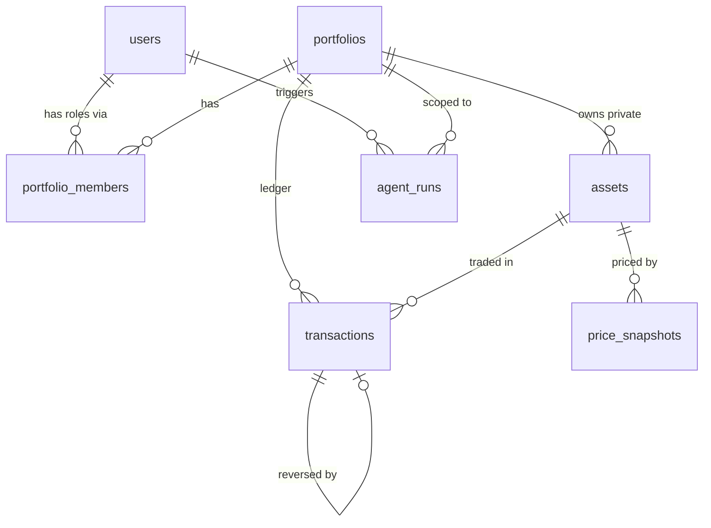

# Database Plan: Wealth Portfolio Tracker

Scope of this file: the schema, migrations, enums, models, seeder, and how to verify them. It replaces sections 4 to 6 of `BUILD_GUIDE.md` where they differ (the main change is soft-deleting portfolios, see 2.4).

**Target:** MySQL 8, Laravel (Breeze React + TypeScript already installed, so the `users` table and auth exist).
**Portability rule:** schema builder only, no raw MySQL DDL, so the project can move to PostgreSQL by changing `DB_CONNECTION`.

---

## 1. Entity overview



| Table | Purpose | Written by |
|---|---|---|
| `users` | Auth (exists from Breeze) | Registration |
| `portfolios` | One tracked portfolio | `CreatePortfolio` |
| `portfolio_members` | Who has which role (owner, editor, viewer) | Member Actions (Owner only) |
| `assets` | Global market assets (`portfolio_id` null) and private manual assets | Seeder, `AddAsset` Action |
| `transactions` | Append-only ledger | `LogTransaction`, `ReverseTransaction` |
| `price_snapshots` | Price history for every asset | Sync job (market), `SetAssetPrice` (manual) |
| `agent_runs` | Audit row per agent tool call | Agent tools |

---

## 2. Design decisions

### 2.1 Money and quantities
- `DECIMAL(24,8)` for `quantity`, `price`, `fee`. Exact arithmetic, and 8 places cover crypto.
- Models cast these as `decimal:8`, which returns strings. Do all math with `bcmath`, never floats.
- `quantity` is always positive. The transaction `type` decides the direction.

### 2.2 Enums as strings
- Columns are `string(16)`, not MySQL `ENUM`. Allowed values live in PHP backed enums (`app/Enums`).
- Reason: adding a value needs no migration, and it behaves the same on PostgreSQL.

### 2.3 Foreign key policy
| FK | On delete | Reason |
|---|---|---|
| `portfolio_members.*` | cascade | Membership rows have no value without their parent |
| `price_snapshots.asset_id` | cascade | Same |
| `assets.portfolio_id` | restrict | Never silently destroy assets |
| `transactions.portfolio_id`, `.asset_id` | restrict | The ledger must outlive everything around it |
| `transactions.reverses_id` | restrict | Keep the reversal chain intact |

### 2.4 Portfolio deletion is a soft delete
"Delete portfolio" sets `deleted_at`. Nothing is destroyed, so the append-only ledger (R5) holds even for deleted portfolios, and no cascade ever touches `transactions`. Eloquent route binding and queries exclude soft-deleted portfolios by default.

### 2.5 Global vs private assets
- `assets.portfolio_id IS NULL`: a shared market asset (BTC, AAPL), priced only by the sync job.
- `assets.portfolio_id = X`: a private asset (real estate, a bank account), priced manually by members of portfolio X.
- `price_source` (`market` or `manual`) is a fixed label. Prices change in `price_snapshots`.
- MySQL allows many `NULL`s in a unique index, so uniqueness of global symbols (`BTC` once) cannot be a DB constraint. It is enforced in the seeder and the asset-creation Action. State this trade-off in the video.

### 2.6 Where each invariant is enforced

| Invariant | DB | App (Action) |
|---|---|---|
| One membership per user per portfolio | unique `(portfolio_id, user_id)` | check before insert for a friendly error |
| A transaction can be reversed once | unique `reverses_id` | `ReverseTransaction` checks first |
| Idempotent logging | unique `idempotency_key` | `LogTransaction` returns the existing row |
| One price per asset, time, source | unique `(asset_id, as_of, source)` | job uses `upsert` |
| R3: asset belongs to the portfolio or is global | no | `usableAssets()` lookup |
| R4: no negative positions | no | position check under `lockForUpdate()` |
| R5: ledger is append-only | FK restrict, no cascade, soft-deleted portfolios | no update/delete routes, model guards |
| At least one Owner per portfolio | no | member Actions |

The DB catches duplicates and orphans. Business rules live in the Actions.

---

## 3. Build order

```
1. Enums
2. Migrations (portfolios -> members -> assets -> transactions -> snapshots -> agent_runs)
3. Models
4. Seeder
5. Verify (migrate:fresh --seed, db:show, tinker, Pest schema test)
```

Commit after each numbered step.

---

## 4. Enums

Create `app/Enums/` (`php artisan make:enum Role` works on recent Laravel, or create the files by hand).

```php
// app/Enums/Role.php
namespace App\Enums;

enum Role: string
{
    case Owner = 'owner';
    case Editor = 'editor';
    case Viewer = 'viewer';

    public function rank(): int
    {
        return match ($this) { self::Owner => 3, self::Editor => 2, self::Viewer => 1 };
    }

    public function atLeast(self $min): bool
    {
        return $this->rank() >= $min->rank();
    }
}
```

```php
// app/Enums/TransactionType.php
namespace App\Enums;

enum TransactionType: string
{
    case Buy = 'buy';
    case Sell = 'sell';
    case Deposit = 'deposit';
    case Withdrawal = 'withdrawal';

    public function isOutflow(): bool
    {
        return in_array($this, [self::Sell, self::Withdrawal], true);
    }

    public function opposite(): self
    {
        return match ($this) {
            self::Buy => self::Sell,
            self::Sell => self::Buy,
            self::Deposit => self::Withdrawal,
            self::Withdrawal => self::Deposit,
        };
    }
}
```

```php
// app/Enums/AssetType.php
enum AssetType: string { case Stock = 'stock'; case Crypto = 'crypto'; case RealEstate = 'real_estate'; case Cash = 'cash'; }

// app/Enums/PriceSource.php
enum PriceSource: string { case Market = 'market'; case Manual = 'manual'; }

// app/Enums/TransactionSource.php
enum TransactionSource: string { case User = 'user'; case Agent = 'agent'; }
```

(Each in its own file with `namespace App\Enums;`.)

---

## 5. Migrations

Create them in this order. Laravel runs migrations sorted by filename, and foreign keys need the parent table to exist first. If two files get the same timestamp, rename them so the order below holds (note that alphabetically `create_assets` would sort before `create_portfolios`).

```bash
php artisan make:migration create_portfolios_table
php artisan make:migration create_portfolio_members_table
php artisan make:migration create_assets_table
php artisan make:migration create_transactions_table
php artisan make:migration create_price_snapshots_table
php artisan make:migration create_agent_runs_table
```

Check with `ls database/migrations` that the timestamps ascend in that order.

### 5.1 portfolios

```php
Schema::create('portfolios', function (Blueprint $table) {
    $table->id();
    $table->string('name');
    $table->char('base_currency', 3)->default('USD');
    $table->foreignId('created_by')->constrained('users')->restrictOnDelete();
    $table->timestamps();
    $table->softDeletes();
});
```

### 5.2 portfolio_members

```php
Schema::create('portfolio_members', function (Blueprint $table) {
    $table->id();
    $table->foreignId('portfolio_id')->constrained()->cascadeOnDelete();
    $table->foreignId('user_id')->constrained()->cascadeOnDelete();
    $table->string('role', 16);               // owner | editor | viewer
    $table->timestamps();

    $table->unique(['portfolio_id', 'user_id']);
    $table->index('user_id');                 // "which portfolios can this user see?"
});
```

### 5.3 assets

```php
Schema::create('assets', function (Blueprint $table) {
    $table->id();
    $table->foreignId('portfolio_id')->nullable()->constrained()->restrictOnDelete(); // null = global
    $table->string('type', 16);               // stock | crypto | real_estate | cash
    $table->string('symbol', 16)->nullable(); // BTC, AAPL. Null for things like a flat
    $table->string('external_id')->nullable(); // id at the price provider, e.g. "bitcoin"
    $table->string('name');
    $table->char('currency', 3)->default('USD');
    $table->string('price_source', 16);       // market | manual (fixed label)
    $table->timestamps();

    $table->index(['portfolio_id', 'symbol']);
});
```

### 5.4 transactions

```php
Schema::create('transactions', function (Blueprint $table) {
    $table->id();
    $table->foreignId('portfolio_id')->constrained()->restrictOnDelete();
    $table->foreignId('asset_id')->constrained()->restrictOnDelete();
    $table->string('type', 16);               // buy | sell | deposit | withdrawal
    $table->decimal('quantity', 24, 8);       // always positive
    $table->decimal('price', 24, 8);          // unit price (1 for cash)
    $table->decimal('fee', 24, 8)->default(0);
    $table->dateTime('occurred_at');
    $table->foreignId('created_by')->constrained('users')->restrictOnDelete();
    $table->string('source', 16)->default('user'); // user | agent
    $table->foreignId('reverses_id')->nullable()->unique()->constrained('transactions')->restrictOnDelete();
    $table->string('idempotency_key', 64)->nullable()->unique();
    $table->text('note')->nullable();
    $table->timestamps();

    $table->index(['portfolio_id', 'asset_id', 'occurred_at']); // position and cost-basis queries
});
```

### 5.5 price_snapshots

```php
Schema::create('price_snapshots', function (Blueprint $table) {
    $table->id();
    $table->foreignId('asset_id')->constrained()->cascadeOnDelete();
    $table->decimal('price', 24, 8);
    $table->char('currency', 3)->default('USD');
    $table->dateTime('as_of');
    $table->string('source', 16);             // market | manual
    $table->foreignId('created_by')->nullable()->constrained('users')->nullOnDelete(); // null for the job
    $table->timestamps();

    $table->unique(['asset_id', 'as_of', 'source']); // makes the sync job idempotent
});
```

### 5.6 agent_runs

```php
Schema::create('agent_runs', function (Blueprint $table) {
    $table->id();
    $table->foreignId('user_id')->constrained()->restrictOnDelete();
    $table->foreignId('portfolio_id')->constrained()->restrictOnDelete();
    $table->string('run_id', 36);             // one per user message
    $table->string('tool', 64);
    $table->json('input');
    $table->string('outcome', 16);            // ok | denied | invalid | error
    $table->text('error')->nullable();
    $table->timestamps();

    $table->index(['portfolio_id', 'created_at']);
});
```

Each `down()` is `Schema::dropIfExists('<table>')`.

**Why these indexes**
- `portfolio_members (user_id)`: the dashboard asks "which portfolios is this user in?".
- `transactions (portfolio_id, asset_id, occurred_at)`: every position query filters by portfolio and asset and orders by time.
- `price_snapshots` unique `(asset_id, as_of, source)`: also serves "latest price per asset" because `asset_id` is its leading column.

---

## 6. Models

```bash
php artisan make:model Portfolio
php artisan make:model PortfolioMember
php artisan make:model Asset
php artisan make:model Transaction
php artisan make:model PriceSnapshot
php artisan make:model AgentRun
```

### 6.1 Portfolio

```php
class Portfolio extends Model
{
    use SoftDeletes;

    protected $fillable = ['name', 'base_currency', 'created_by'];

    public function members(): HasMany { return $this->hasMany(PortfolioMember::class); }
    public function transactions(): HasMany { return $this->hasMany(Transaction::class); }

    public function roleFor(User $user): ?Role
    {
        $value = $this->members()->where('user_id', $user->id)->value('role');
        return $value ? Role::from($value) : null;
    }

    /** Global assets plus this portfolio's private ones. This is the R3 boundary. */
    public function usableAssets(): Builder
    {
        return Asset::query()->where(
            fn ($q) => $q->whereNull('portfolio_id')->orWhere('portfolio_id', $this->id)
        );
    }
}
```

### 6.2 PortfolioMember

```php
class PortfolioMember extends Model
{
    protected $fillable = ['portfolio_id', 'user_id', 'role'];
    protected $casts = ['role' => Role::class];

    public function portfolio(): BelongsTo { return $this->belongsTo(Portfolio::class); }
    public function user(): BelongsTo { return $this->belongsTo(User::class); }
}
```

Note: `Portfolio::roleFor()` reads the raw string and builds the enum itself. That is fine, and it keeps the query to one column.

### 6.3 Asset

```php
class Asset extends Model
{
    protected $fillable = ['portfolio_id', 'type', 'symbol', 'external_id', 'name', 'currency', 'price_source'];
    protected $casts = ['type' => AssetType::class, 'price_source' => PriceSource::class];

    public function portfolio(): BelongsTo { return $this->belongsTo(Portfolio::class); }
    public function snapshots(): HasMany { return $this->hasMany(PriceSnapshot::class); }

    public function latestSnapshot(): HasOne
    {
        return $this->hasOne(PriceSnapshot::class)->latestOfMany('as_of');
    }

    public function isGlobal(): bool { return $this->portfolio_id === null; }
}
```

### 6.4 Transaction (append-only)

```php
class Transaction extends Model
{
    protected $guarded = [];
    protected $casts = [
        'type' => TransactionType::class,
        'source' => TransactionSource::class,
        'quantity' => 'decimal:8',
        'price' => 'decimal:8',
        'fee' => 'decimal:8',
        'occurred_at' => 'datetime',
    ];

    // R5: second line of defense. The real guarantee is that no route or Action updates or deletes rows.
    protected static function booted(): void
    {
        static::updating(fn () => throw new LogicException('Ledger rows are immutable.'));
        static::deleting(fn () => throw new LogicException('Ledger rows cannot be deleted.'));
    }

    public function portfolio(): BelongsTo { return $this->belongsTo(Portfolio::class); }
    public function asset(): BelongsTo { return $this->belongsTo(Asset::class); }
    public function author(): BelongsTo { return $this->belongsTo(User::class, 'created_by'); }
    public function reverses(): BelongsTo { return $this->belongsTo(self::class, 'reverses_id'); }
    public function reversal(): HasOne { return $this->hasOne(self::class, 'reverses_id'); }
}
```

`$guarded = []` is acceptable here because rows are only created inside Actions with explicit field lists, never from `$request->all()`. Say that on camera.

### 6.5 PriceSnapshot and AgentRun

```php
class PriceSnapshot extends Model
{
    protected $fillable = ['asset_id', 'price', 'currency', 'as_of', 'source', 'created_by'];
    protected $casts = ['price' => 'decimal:8', 'as_of' => 'datetime'];

    public function asset(): BelongsTo { return $this->belongsTo(Asset::class); }
}

class AgentRun extends Model
{
    protected $fillable = ['user_id', 'portfolio_id', 'run_id', 'tool', 'input', 'outcome', 'error'];
    protected $casts = ['input' => 'array'];
}
```

`upsert()` in the sync job bypasses model events and mass-assignment, so the unique key is what protects it.

### 6.6 User additions

```php
public function memberships(): HasMany { return $this->hasMany(PortfolioMember::class); }

public function portfolios(): BelongsToMany
{
    return $this->belongsToMany(Portfolio::class, 'portfolio_members')->withPivot('role')->withTimestamps();
}
```

---

## 7. Seeder

Demo data for development, the video, and tests of the dashboard.

```php
// database/seeders/DatabaseSeeder.php
public function run(): void
{
    // Users (the Breeze factory's default password is "password")
    $alice = User::factory()->create(['name' => 'Alice', 'email' => 'alice@example.com']);
    $bob   = User::factory()->create(['name' => 'Bob',   'email' => 'bob@example.com']);
    $carol = User::factory()->create(['name' => 'Carol', 'email' => 'carol@example.com']);

    // Global market assets. firstOrCreate keeps symbols unique (the DB cannot, see 2.5)
    $btc = Asset::firstOrCreate(['portfolio_id' => null, 'symbol' => 'BTC'],
        ['type' => 'crypto', 'external_id' => 'bitcoin', 'name' => 'Bitcoin', 'price_source' => 'market']);
    $eth = Asset::firstOrCreate(['portfolio_id' => null, 'symbol' => 'ETH'],
        ['type' => 'crypto', 'external_id' => 'ethereum', 'name' => 'Ethereum', 'price_source' => 'market']);
    $aapl = Asset::firstOrCreate(['portfolio_id' => null, 'symbol' => 'AAPL'],
        ['type' => 'stock', 'name' => 'Apple Inc.', 'price_source' => 'market']);

    foreach ([[$btc, '65000'], [$eth, '3200'], [$aapl, '230']] as [$asset, $price]) {
        PriceSnapshot::updateOrCreate(
            ['asset_id' => $asset->id, 'as_of' => now()->startOfMinute(), 'source' => 'market'],
            ['price' => $price, 'currency' => 'USD'],
        );
    }

    // Family portfolio: Alice owner, Bob editor, Carol viewer
    $family = Portfolio::create(['name' => 'Family wealth', 'base_currency' => 'USD', 'created_by' => $alice->id]);
    $family->members()->createMany([
        ['user_id' => $alice->id, 'role' => 'owner'],
        ['user_id' => $bob->id,   'role' => 'editor'],
        ['user_id' => $carol->id, 'role' => 'viewer'],
    ]);

    // Private asset with a manual valuation
    $flat = Asset::create(['portfolio_id' => $family->id, 'type' => 'real_estate', 'name' => 'Damascus flat',
        'currency' => 'USD', 'price_source' => 'manual']);
    PriceSnapshot::create(['asset_id' => $flat->id, 'price' => '85000', 'currency' => 'USD',
        'as_of' => now(), 'source' => 'manual', 'created_by' => $alice->id]);

    // A few ledger rows (direct inserts are fine for seed data)
    $rows = [
        [$btc,  'buy',  '0.5',  '60000'],
        [$eth,  'buy',  '4',    '3000'],
        [$aapl, 'buy',  '10',   '210'],
        [$flat, 'buy',  '1',    '80000'],
    ];
    foreach ($rows as [$asset, $type, $qty, $price]) {
        Transaction::create([
            'portfolio_id' => $family->id, 'asset_id' => $asset->id, 'type' => $type,
            'quantity' => $qty, 'price' => $price, 'fee' => 0, 'occurred_at' => now()->subDays(30),
            'created_by' => $alice->id, 'source' => 'user',
        ]);
    }

    // A second portfolio to prove isolation (used by the R3 tests)
    $other = Portfolio::create(['name' => 'Carol personal', 'base_currency' => 'USD', 'created_by' => $carol->id]);
    $other->members()->create(['user_id' => $carol->id, 'role' => 'owner']);
}
```

Seeding is not idempotent for users and portfolios, so use `php artisan migrate:fresh --seed` and never run `db:seed` twice.

---

## 8. Verification

```bash
php artisan migrate:fresh --seed
php artisan db:show                  # lists tables
php artisan db:table transactions    # check types, indexes, FKs
php artisan tinker
```

In Tinker:

```php
Portfolio::first()->roleFor(User::where('email','bob@example.com')->first());          // Role::Editor
Portfolio::first()->usableAssets()->pluck('symbol','name');                            // BTC, ETH, AAPL + the flat
Asset::where('symbol','BTC')->first()->latestSnapshot->price;                          // "65000.00000000"
Transaction::first()->update(['note' => 'x']);                                         // throws LogicException
```

Schema Pest test (`tests/Feature/SchemaTest.php`):

```php
uses(RefreshDatabase::class);

test('membership is unique per user and portfolio', function () {
    $user = User::factory()->create();
    $p = Portfolio::create(['name' => 'P', 'base_currency' => 'USD', 'created_by' => $user->id]);
    $p->members()->create(['user_id' => $user->id, 'role' => 'owner']);

    expect(fn () => $p->members()->create(['user_id' => $user->id, 'role' => 'viewer']))
        ->toThrow(QueryException::class);
});

test('a transaction can only be reversed once at the database level', function () {
    // create a base transaction, then two rows with the same reverses_id -> QueryException
});

test('price snapshot is unique per asset, time and source', function () {
    // two inserts with the same (asset_id, as_of, source) -> QueryException
});

test('money keeps eight decimal places', function () {
    // log 0.00000001, reload, expect (string) $tx->quantity === '0.00000001'
});
```

---

## 9. Checklist

- [ ] Enums created (`Role`, `TransactionType`, `AssetType`, `PriceSource`, `TransactionSource`)
- [ ] Six migrations in the right order, `php artisan migrate:fresh` passes
- [ ] Six models with casts and relations, `User` relations added
- [ ] Seeder runs, `db:show` and Tinker checks look right
- [ ] Schema Pest tests pass
- [ ] Committed. Message idea: "Add ledger schema, enums and models"

---

## 10. Questions you should be able to answer

1. Why `DECIMAL(24,8)` and strings instead of floats?
2. Why is the ledger append-only, and how do corrections work? (`reverses_id`, unique, soft-deleted portfolios.)
3. Why is `portfolio_id` nullable on `assets`, and what is the cost? (Unique global symbols are enforced in code.)
4. Why no MySQL `ENUM` columns?
5. Which invariants are enforced by the database and which by Actions, and why that split?
6. What would change for PostgreSQL? (Config only. Possibly add partial unique index for global symbols and row-level security as hardening.)
